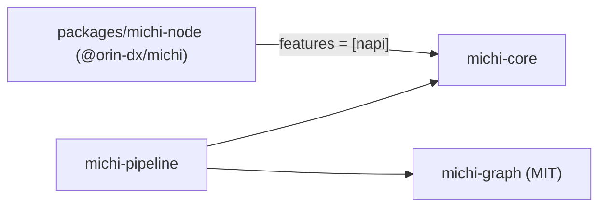
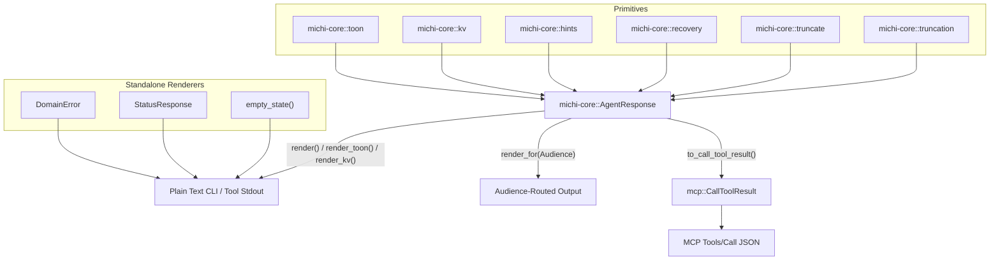

# Architecture

This document describes how the `michi` workspace crates fit together.

## Workspace Layout

`michi` is structured as a virtual Cargo workspace (the root `Cargo.toml` has no `[package]`) with two published crates in `crates/` and one unpublished binding crate in `packages/`:

```text
michi (workspace root, virtual manifest)
├── crates/
│   ├── michi-core        # Every sync primitive: toon, kv, hints, recovery, empty, error, status, mcp, audience,
│   │                     #   response (AgentResponse), pipeline (data type), truncate, truncation, resilience, telemetry;
│   │                     #   napi (feature)
│   ├── michi-graph       # MIT, no dependencies: dependency graphs (GraphBuilder, Graph, Dag), validation, order, layers
│   └── michi-pipeline    # Async pipeline execution: Plan, execute/resume, RunRecord, BreakerRegistry, CancellationToken
└── packages/michi-node   # Node.js NAPI cdylib (@orin-dx/michi), publish = false
```

Dependency direction:



`michi-core`, `michi-pipeline` and `michi-node` version in lockstep (each crate's `version`, kept equal by Callisto), released together as a Callisto fixed group. `michi-graph` is MIT, depends on nothing in michi and versions on its own; `michi-pipeline` takes it through a normal `^` range and keeps its types out of its public API. `michi-pipeline` and `michi-node` depend on `michi-core` through an exact `=x.y.z` workspace pin, so a mixed set never resolves.

## Component Overview

| Crate / Package | Responsibility | Runtime Dependencies |
| --- | --- | --- |
| `michi-core` | All sync AXI primitives. `toon`: TOON list rendering and parsing with stack-inlined `CompactString` cells. `truncate`: UTF-8 char-boundary content truncation (`floor_char_boundary`). `truncation`: `TruncationOutcome`, the report of what a list cap cut. `resilience`: retry back-off math, `Retry-After` HTTP date parsing, FNV-1a idempotency keys. Response DTOs: `AgentResponse`, `DomainError`, `StatusResponse`, `CallToolResult`, and the `Pipeline` data type. The public `resilience`, `truncate` and `truncation` items are re-exported at the crate root by explicit list. | `thiserror`, `compact_str` (Optional: `serde`, `serde_json`, `schemars`, `miette`, `napi`, `napi-derive`) |
| `michi-pipeline` | Async execution of a validated `Plan` of steps: one `JoinSet` scheduler (sequential or capped parallel), a returned `RunRecord` whose statuses are `michi-core`'s `StepStatus`, `resume` from a record, a keyed `BreakerRegistry`, a per-run `RetryBudget`, `CancellationToken` and a `StepObserver`. Own `ExecutionError` and `PlanError` types, converting into `DomainError` via `From` — not variants of `michi_core::Error`. See `docs/spec/08-pipeline-execution.md`. | `michi-core`, `michi-graph`, `tokio`, `tokio-util`, `thiserror` (optional: `serde`) |
| `michi-graph` | MIT, `no_std` + `alloc`. Deterministic dependency graphs: `GraphBuilder` declares nodes and kinded edges, `Graph` may hold cycles, and validation returns a `Dag` or every violation at once. Topological order, layers, ready sets, ancestors and descendants, all following one caller-chosen tie-break. See `docs/spec/09-graph.md`. | none |
| `packages/michi-node` | NAPI cdylib shim for `@orin-dx/michi`. Not published to crates.io. | `michi-core` (`napi` feature), `napi`, `napi-derive` |

## Data Composition & Render Flow

`michi` provides two main entry points for formatting output:

1. **`response::AgentResponse` (Fluent Builder)**: Composes TOON lists, KV items, `help[]` hints, and recovery guidance into a unified output buffer. Supports assistant/user audience routing and direct conversion to MCP `CallToolResult`.
2. **Standalone DTOs**: `DomainError`, `StatusResponse`, `AlreadyDone`, and `empty_state()` render themselves directly into agent-readable KV blocks or GitHub Actions annotations without passing through `AgentResponse`.



## Node.js / NAPI Bridge (`packages/michi-node`)

The Node.js native addon lives in `packages/michi-node` because Cargo requires a separate `cdylib` target definition:

- Public FFI exports, input validation, and bounds checking live in `crates/michi-core/src/napi.rs` (numeric newtypes in `napi/num.rs`), compiled only with `michi-core`'s `napi` feature.
- `packages/michi-node/src/lib.rs` re-exports those functions across the crate boundary via `pub use michi_core::napi::*;`.
- `napi-derive` uses linker sections (`ctor`) to register native functions across crate boundaries without manual wrapper boilerplates.

## NAPI Boundary Contract

The NAPI boundary (`crates/michi-core/src/napi.rs`) has a specific constructor discipline that differs from pure-Rust callers:

**NAPI functions always use normalizing constructors (`new()`), never strict ones (`try_new()`).**

- `RetryConfig::new()` normalizes out-of-range inputs silently (clamps `jitter_factor`, floors `max_delay`, etc.). `napi.rs`'s resilience-domain call sites use it this way; making it fallible there would require either `unwrap()`/`expect()` (banned) or a silent fallback to `Default` (defeats validation).
- Pure-Rust callers and tests may use `try_new()` / `validate()` for explicit error signals.
- JS-facing functions report errors via `napi::Error`, not `Result` propagation — validation that can't be normalized (truly invalid JS input) becomes a JS exception at the boundary, not a Rust panic.

This asymmetry is intentional. The NAPI layer operates in a "be maximally resilient to JS input, fail loudly only for truly unrecoverable cases" mode; the Rust library layer operates in a "signal problems explicitly through types" mode.

**Error output path:** When you hold a `DomainError`, call `domain_error.to_call_tool_result()` directly. Do not wrap it in `AgentResponse::as_error()` — that double-wraps the render and loses the typed `error`/`retryable` fields from `structured_content`. Both `AgentResponse::to_call_tool_result()` and `DomainError::to_call_tool_result()` produce structurally compatible `structured_content` JSON (same top-level keys).
