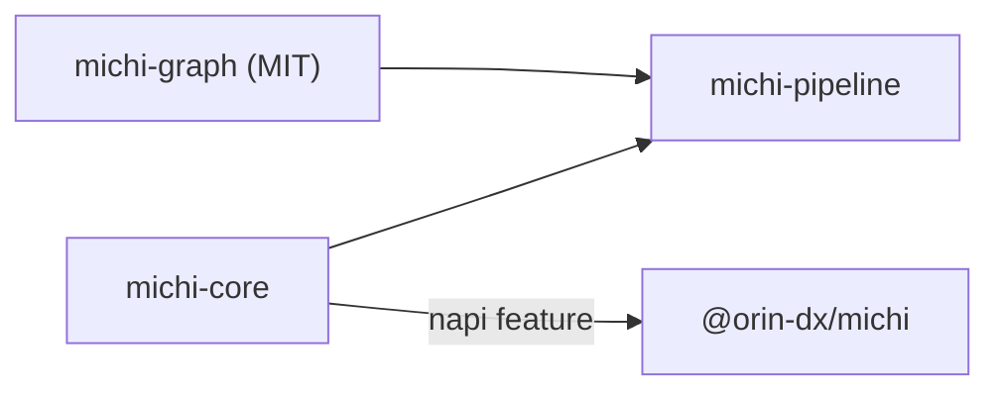

<p align="center">
  <picture>
    <source media="(prefers-color-scheme: dark)" srcset="https://raw.githubusercontent.com/orin-dx/michi/main/assets/brand/hero-dark.png">
    
  </picture>
</p>

<p align="center">道</p>

[](https://github.com/orin-dx/michi/actions/workflows/ci.yml) [](https://github.com/orin-dx/michi/blob/main/LICENSE)

AXI response primitives for agent-ergonomic tools — TOON lists, key-value blocks, truncation, structured errors, status, and `help[]` hints.

`michi` is the formatting and response layer for the [Orin DX](https://orin-dx.com) tools: it turns structured data into token-efficient, agent-readable text. No CLI framework or async runtime required.

Available as Rust crates (`michi-core`, plus `michi-pipeline` for async execution and the MIT `michi-graph` for dependency graphs) or a Node.js package (`@orin-dx/michi`).

For developer docs, start with the [documentation map](https://github.com/orin-dx/michi/blob/main/docs/README.md). API reference: [michi-core](https://docs.rs/michi-core), [michi-pipeline](https://docs.rs/michi-pipeline) and [michi-graph](https://docs.rs/michi-graph) on docs.rs.

## Install

Rust:

```bash
cargo add michi-core
cargo add michi-pipeline   # optional: async pipeline execution on Tokio
cargo add michi-graph      # optional: dependency graphs (MIT, no dependencies)
```

Node.js:

```bash
npm i @orin-dx/michi
```

The npm package ships prebuilt native binaries for these platforms:

- macOS on Apple silicon (`darwin-arm64`)
- macOS on Intel (`darwin-x64`)
- Linux x64 with glibc (`linux-x64-gnu`)
- Linux x64 with musl (`linux-x64-musl`)
- Linux arm64 with glibc (`linux-arm64-gnu`)
- Linux arm64 with musl (`linux-arm64-musl`)

Windows isn't supported yet.

## Why TOON?

Agents pay for every token they read. Standard JSON lists repeat keys on every single object, burning context window capacity:

```json
[
  { "number": 51815, "title": "[Bug]: Telegram plugin", "state": "open" },
  { "number": 51812, "title": "dark mode request", "state": "open" }
]
```

TOON (Token-Oriented Object Notation) states field names once in a tabular header:

```text
issues[2]{number,title,state}:
  51815,"[Bug]: Telegram plugin",open
  51812,dark mode request,open
```

For a 100-row list TOON is a median 47% smaller than pretty JSON and 23% smaller than minified JSON, and models (Claude Haiku, Sonnet and Opus, and OpenAI's GPT-6 Sol) answer questions about it as accurately as about JSON or Markdown: no loss in accuracy, much more data per context window. Numbers and method: [TOON benchmarks](https://github.com/orin-dx/michi/blob/main/docs/toon-benchmarks.md).

Output conforms to the [TOON 4.4 specification](https://github.com/toon-format/spec/blob/main/SPEC.md) — every agent-facing block, not just lists: key-value blocks, errors, status, recovery hints and partial-success reports are TOON documents too, so an agent parses one format. Values are quoted only when the spec requires it — a delimiter, colon, bracket, quote, line break, or a value that would otherwise read as a number, boolean or `null` — so the common case carries no quoting overhead.

## Quick start

### Rust

```rust
use michi_core::toon::{render_toon, ToonOptions, Value};

fn main() -> Result<(), Box<dyn std::error::Error>> {
    let opts = ToonOptions::new(
        "issues",
        vec!["number".to_string(), "title".to_string(), "state".to_string()],
        vec![
            vec![Value::Int(51815), Value::from("[Bug]: Telegram plugin"), Value::from("open")],
            vec![Value::Int(51812), Value::from("dark mode request"), Value::from("open")],
        ],
    )
    .total_count(Some(8771))
    .hints(vec!["Run `gh-axi issue view <number>` to view an issue".to_string()]);

    print!("{}", render_toon(&opts)?);
    Ok(())
}
```

### TypeScript / Node.js

```typescript
import { renderToon } from "@orin-dx/michi";

const out = renderToon({
  typeName: "issues",
  fields: ["number", "title", "state"],
  rows: [
    [
      { type: "int", intVal: 51815 },
      { type: "str", strVal: "[Bug]: Telegram plugin" },
      { type: "str", strVal: "open" },
    ],
    [
      { type: "int", intVal: 51812 },
      { type: "str", strVal: "dark mode request" },
      { type: "str", strVal: "open" },
    ],
  ],
  totalCount: 8771,
  hints: ["Run `gh-axi issue view <number>` to view an issue"],
});

process.stdout.write(out);
```

### Output

```text
issues[2]{number,title,state}:
  51815,"[Bug]: Telegram plugin",open
  51812,dark mode request,open
totalCount: 8771
help[1]: Run `gh-axi issue view <number>` to view an issue
```

## Workspace Architecture

`michi` is organized as a Cargo workspace with three published crates. `michi-core` holds every sync primitive and by default depends only on `thiserror` and `compact_str`; `michi-pipeline` adds async execution on `tokio`; `michi-graph` (MIT, no dependencies) validates and orders dependency graphs. Optional features live on `michi-core`:



| Crate / Package | Description |
| --- | --- |
| `michi-core` | All sync AXI primitives: TOON list rendering (`toon`; render only, no public parser), key-value blocks, hints, structured errors (`DomainError`), status, recovery hints, MCP `CallToolResult`, the `AgentResponse` builder, UTF-8 char-boundary truncation (`truncate`), the report of what a list cap cut (`truncation`), and retry/back-off math with `Retry-After` parsing and idempotency keys (`resilience`). |
| `michi-pipeline` | Async pipeline execution: a validated step plan run sequentially or with a concurrency cap (overall and per key), a per-step run record with replay-honest statuses, resume, keyed circuit breakers, a retry budget, shared deadline groups, poll and blocking steps, and cancellation. Depends on `michi-core`, `michi-graph`, `tokio` and `tokio-util`. |
| `michi-graph` | Deterministic dependency graphs, MIT-licensed with no dependencies: validation that reports every problem at once (with a concrete loop for each cycle), topological order, layers, ready sets (also judged per edge kind), ancestors and descendants. |
| `@orin-dx/michi` | Node.js NAPI bindings built with `@napi-rs/cli` from `packages/michi-node`, which re-exports `michi-core`'s `napi` feature surface. |

`michi-core`, `michi-graph`, `michi-pipeline` and `@orin-dx/michi` version in lockstep. The crate name `michi` on crates.io belongs to an unrelated project; to write `use michi::...`, rename the dependency in `Cargo.toml`:

```toml
michi = { package = "michi-core", version = "0.7" }
```

## Feature Flags

| Feature | Adds | Purpose |
| --- | --- | --- |
| `serde` | `serde`, `serde_json` | Enables `Serialize`/`Deserialize` on types and direct `toon::list()` generation. |
| `schemars` | `schemars` 1.x | Derives `JsonSchema` on DTO types for automatic MCP `outputSchema` generation (JSON Schema 2020-12). |
| `miette` | `miette` | Implements `miette::Diagnostic` for `DomainError` to render colorized CLI diagnostic cards. |
| `napi` | `napi`, `napi-derive`, `serde_json` | Enables Node.js native addon compilation. |

These are `michi-core` features. The default build (`default = []`) has no runtime dependencies beyond `thiserror` and `compact_str`.

## Local Development

```bash
just check-all   # Run formatting, clippy, rustdoc, and test suites
just test        # Run Rust tests and Node.js NAPI tests
just bench       # Run Divan performance benchmarks
```

## License

FSL-1.1-MIT — Functional Source License, converting to MIT two years after each release. `michi-graph` is MIT ([`crates/michi-graph/LICENSE`](https://github.com/orin-dx/michi/blob/main/crates/michi-graph/LICENSE)). See [`LICENSE`](https://github.com/orin-dx/michi/blob/main/LICENSE).
